# LeadFlow

A single-screen lead management tool. Reps can see their leads, log every discussion, set follow-up reminders and update lead status.

Built for the Pravar AI assignment. **Stack:** Next.js 14 (TypeScript) + FastAPI + SQLite.

## Screenshots


### Home Page
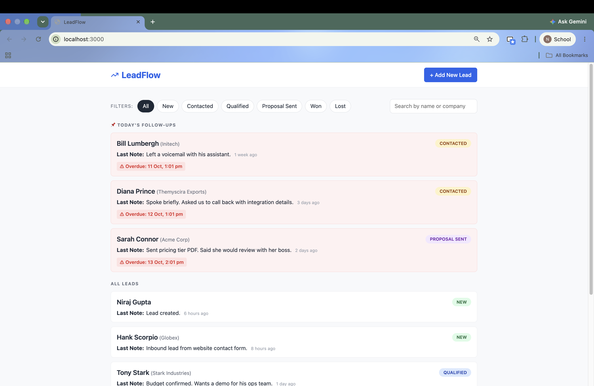

### All Leads
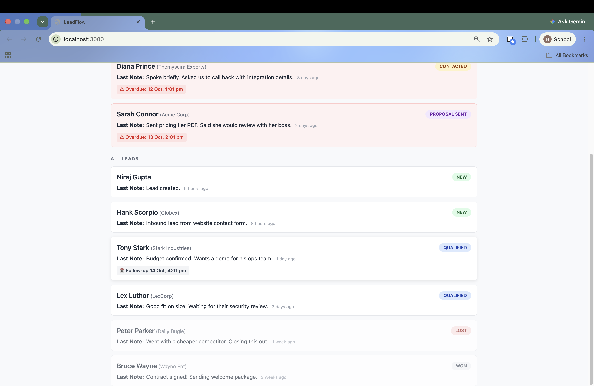

### Add New Lead
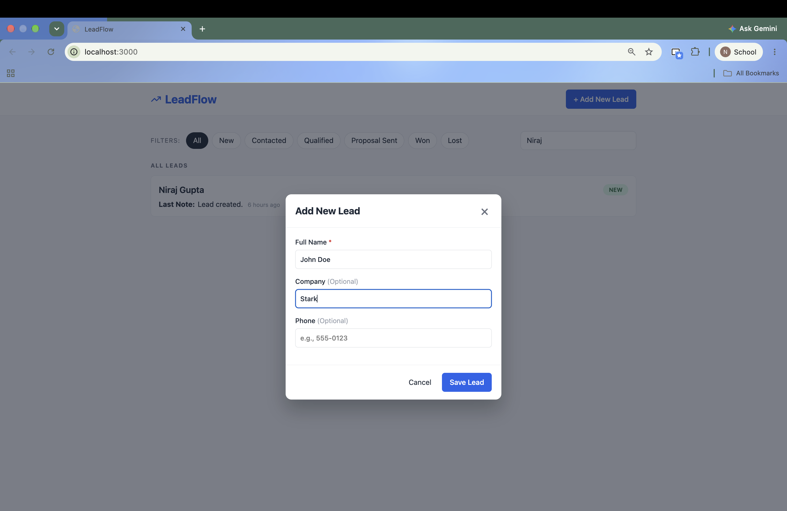

### View Lead
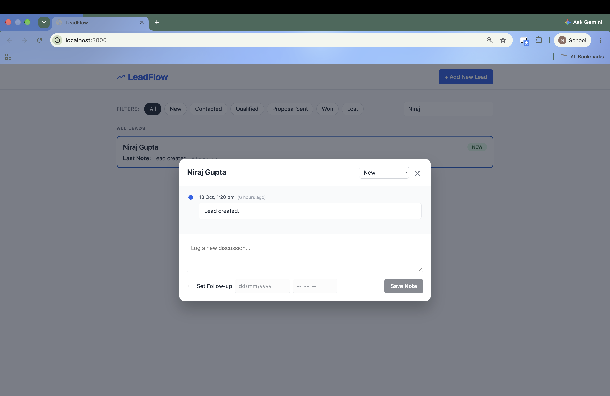

### Edit Lead
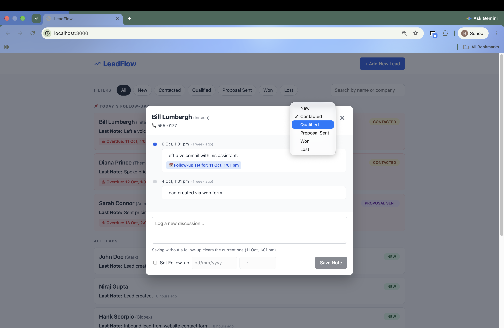

### New Lead Tab
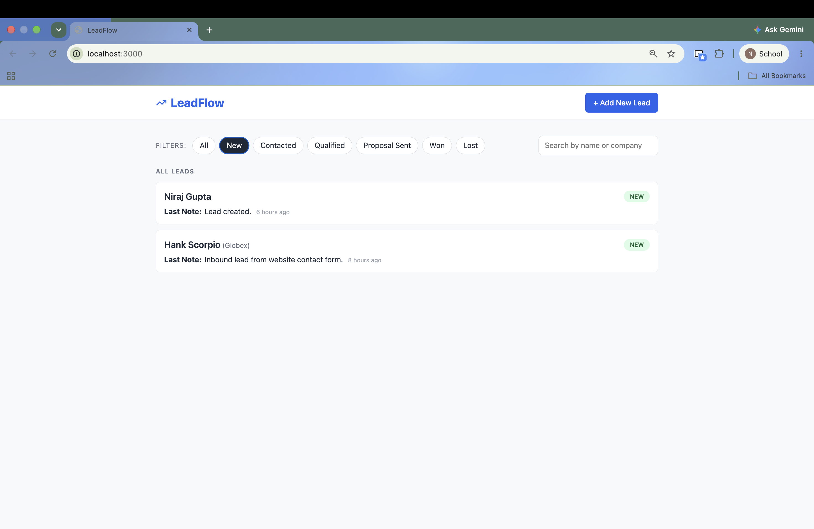

### Contacted Lead
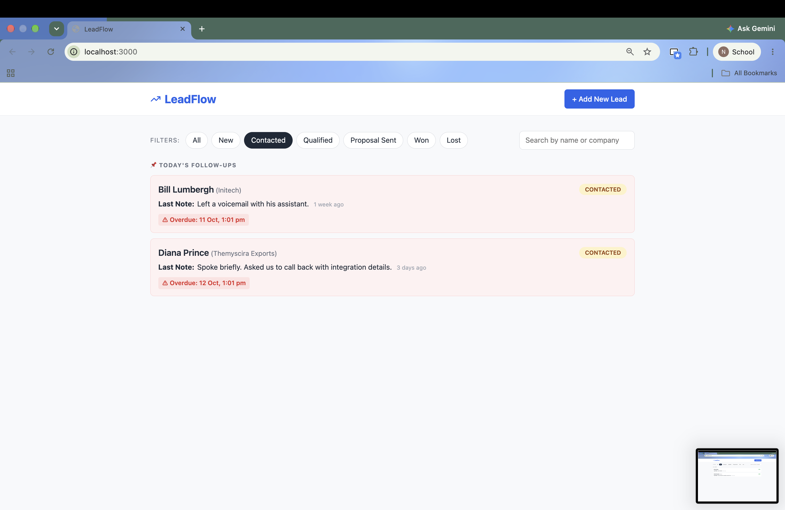

### Qualified Lead
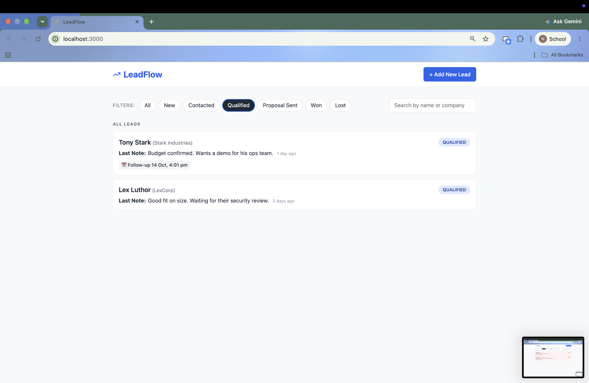

### Proposal Sent Tab
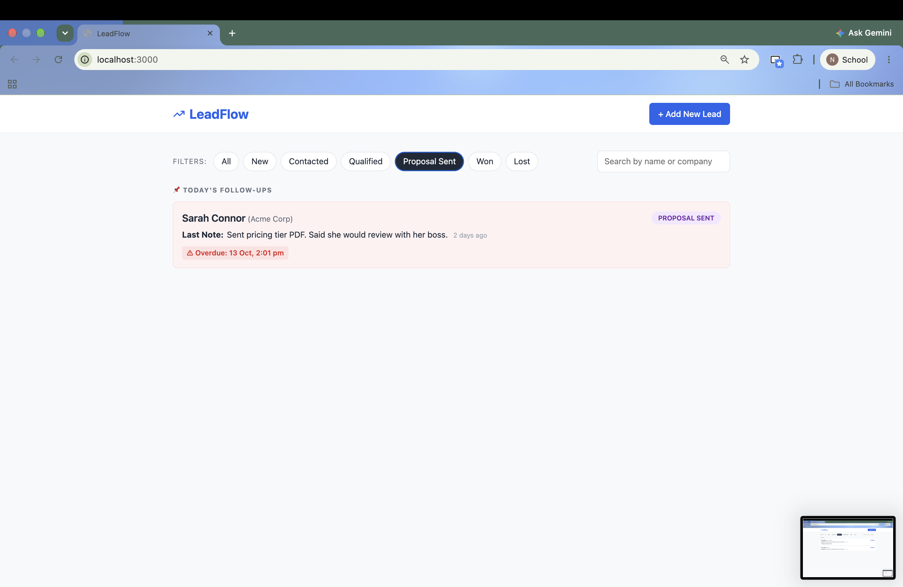

### Won Tab
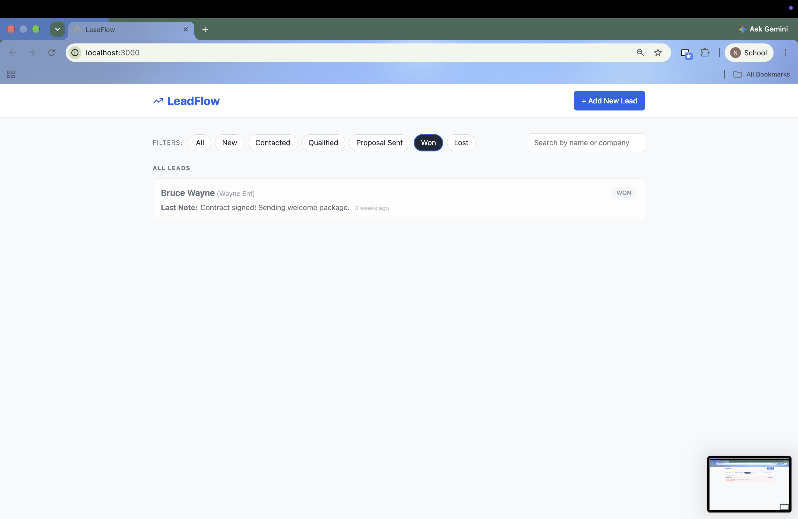

### Lost Tab
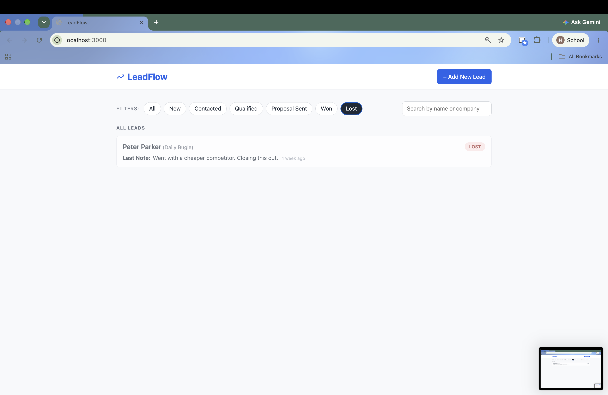

## Features

- Lead list with name, company, status badge, last note and time since last discussion
- Filter by status (All, New, Contacted, Qualified, Proposal Sent, Won, Lost)
- Search by name or company
- Today's follow-ups pinned at the top. Overdue ones are pinned too and shown in red
- Click a lead to open a dialog with the full discussion history (newest first)
- Add a note with an optional follow-up date and time. The list updates straight away
- Change status from the dialog
- Add a new lead (name required, company and phone optional, status starts as New)
- Seed script with 8 leads and their discussions
- Docker Compose setup

## Run with Docker

```bash
cp .env.example .env     # optional, the defaults work
docker compose up --build
```

- App: http://localhost:3000
- API docs: http://localhost:8000/docs

Sample data is loaded on first start.

## Run without Docker

You need Python 3.10+ and Node 18+.

**Backend**

```bash
cd backend
python -m venv .venv && source .venv/bin/activate
pip install -r requirements.txt
python seed.py            # optional: load sample data (use --reset to start again)
uvicorn app.main:app --reload --port 8000
```

**Frontend** (in a second terminal)

```bash
cd frontend
cp .env.example .env.local
npm install
npm run dev
```

Open http://localhost:3000.

## Tests

```bash
cd backend
pytest
```

The tests cover creating leads, validation, notes, follow-ups, status updates, filters, search and 404 errors.

## Environment variables

See `.env.example`.

| Name | Used by | Purpose |
| --- | --- | --- |
| `DATABASE_URL` | backend | Database location. Default is a local SQLite file |
| `CORS_ORIGINS` | backend | Websites allowed to call the API |
| `NEXT_PUBLIC_API_URL` | frontend | API address as seen from the browser |

## API

| Method and path | What it does | Success | Errors |
| --- | --- | --- | --- |
| `GET /leads?status=&search=` | List leads with last note, most recently touched first | 200 | 422 bad status |
| `POST /leads` | Create a lead | 201 | 422 missing or blank name |
| `GET /leads/{id}` | Get one lead | 200 | 404 |
| `PATCH /leads/{id}` | Update status | 200 | 404, 422 |
| `GET /leads/{id}/discussions` | Discussion history, newest first | 200 | 404 |
| `POST /leads/{id}/discussions` | Add a note, optional `follow_up_at` | 201 | 404, 422 empty note |

Interactive docs are at `/docs`.

## Project layout

```
backend/
  app/main.py            app setup, CORS, error handling
  app/models.py          database tables
  app/schemas.py         request and response shapes, validation
  app/routers/leads.py   all endpoints
  seed.py                sample data
  tests/                 API tests
frontend/
  app/page.tsx           the single screen
  components/            LeadCard, LeadDialog, AddLeadDialog, FilterBar, StatusBadge, Modal
  lib/                   API calls, time helpers, types
```

## Decisions worth knowing

- **Follow-up rule.** The lead holds one follow-up. Saving a note with a follow-up replaces it. Saving a note without one clears it, on the thinking that logging a new discussion means the old follow-up was dealt with. The dialog warns about this before saving.
- **Time zones.** Times are stored in UTC. The browser works out "today" and "overdue" using the user's own time zone.
- **Won and Lost leads** are never pinned or marked overdue.
- **New leads** get an automatic "Lead created." entry so the timeline is never empty.
- **SQLite** keeps setup simple for a take-home. For real use I would move to PostgreSQL and add migrations.


## AI use

AI (Claude) was used to generate the first version of the backend, frontend, tests and this README. I reviewed, ran and tested it myself.
